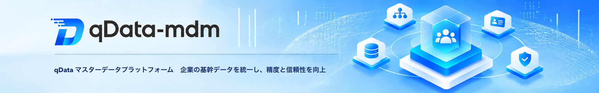

  
  
  
  
  

  
  

  <a href="README.zh-CN.md">📖简体中文</a> | <a href="README.md">📖English</a> | 📖日本語

## プラットフォーム概要

**qData マスターデータプラットフォーム**は、顧客、仕入先、品目、組織などのマスターデータを一元管理します。業務ドメインごとにモデルを定義し、複数のシステムで同じ対象を表すレコードを照合・統合します。品質チェックと承認を経た統合結果を正本として管理し、データ配信や照会 API を通じて各システムで共有できます。元のレコードと変更履歴をたどることで、データの出所と変更内容を確認できます。

✨✨✨**オンラインドキュメント**✨✨✨ <a href="https://qdata.qiantong.tech" target="_blank">https://qdata.qiantong.tech</a>

✨✨✨**オープンソース版デモ**✨✨✨ <a href="https://demo-mdm.qdata.tech" target="_blank">https://demo-mdm.qdata.tech</a>（ユーザー名 `qData`、パスワード `qData123`）

✨✨✨**プロフェッショナル版デモ**✨✨✨ <a href="https://pro-demo-mdm.qdata.tech" target="_blank">https://pro-demo-mdm.qdata.tech</a>。デモアカウントの取得は[カスタマーサービスにお問い合わせ](https://community.qdata.tech/business/policy.html)ください。

> qData-mdm が役に立ったら、開発を応援するために **Star ⭐️** をお願いします。

## 機能一覧

| モジュール | 主な機能・画面 | できること |
| --- | --- | --- |
| **ダッシュボード** | ダッシュボード | 権限の範囲内で、マスターデータ、モデル、ドメイン、参照データ項目、有効な権限付与の件数を確認できます。ドメイン別・状態別の件数や直近 7 日・30 日間に反映された変更から明細を開き、モデルの公開失敗や権限の期限切れ予告も確認できます。 |
| **マスターデータ管理** | マスターデータ正本、自分の申請、データ入力タスク、タスクセンター | 公開済みモデルに従って登録・編集・複製・入出力を行い、一括変更は全件を検証してまとめて反映します。有効・凍結・無効・アーカイブの状態管理、版の比較、復元申請に対応します。自分の申請を追跡・撤回し、承認・入力・是正の依頼をタスクセンターで処理できます。 |
| **モデル管理** | ドメイン、モデルカタログ、モデル、階層と関連、参照データ、採番方式 | 通常モデルと分類モデルをドメイン・フォルダー別に整理します。項目、モデル参照、1 対多の子モデルを定義し、依存関係を図で確認できます。項目には参照データや複数の要素を組み合わせた採番ルールを設定できます。検証・承認後に手動で公開すると物理スキーマが生成され、改訂時は互換性を検証して旧版を保持します。 |
| **ルール管理** | 照合ルール、値の採用ルール、品質ルール | 完全一致、正規化後の一致、あいまい一致、複数項目の重み付き照合で重複候補を検出します。取り込み元の優先順位・信頼度、値の新しさ、空値かどうかを基準に項目値を選びます。必須、形式、範囲、一意性、参照値、項目間の整合性を検証できます。 |
| **ワークフロー管理** | フロー設定、フロー実行履歴 | モデル、レコードの内容・状態の変更、統合結果を承認に回し、現在のステップ、担当者、コメント、承認履歴を確認できます。承認済みモデルは手動で公開し、レコードの変更と統合結果は承認後に業務ルールに従って反映します。 |
| **データ取り込み** | ソースシステム、取り込みタスク、ソースレコード | データベースの全件・差分読み込み、CSV/XLS/XLSX の取り込み、外部 API からの取得に対応します。ソース側のキーでレコードを特定し、項目をモデルに対応付けます。変更のないレコードはスキップし、変更があれば新版を保存します。失敗の詳細は実行単位で確認できます。 |
| **複数ソースの統合** | 重複検出、照合結果のレビュー、マージ管理 | スコアと一致の根拠を確認し、候補グループを確定・分割・保留できます。単独レコードは個別に確認し、複数ソース間の競合は項目ごとに解消して採用値の出所を記録します。品質チェックと承認を経て、正本を新規登録または更新します。 |
| **データ品質管理** | 品質チェックタスク、問題レコード、是正タスク | 正本を手動または定期的に検査し、違反したルール、項目、原因をレコードごとにまとめます。問題項目ごとに是正担当者を割り当てられます。再検査に合格した項目は解決済みとなり、問題レコードは管理者の確認後にクローズします。 |
| **データ配信** | 配信先システム、配信タスク、データサービス | 配信先 API ごとに対象範囲、項目の対応、実行スケジュールを設定します。全件・差分の配信に加え、配信済みレコードの状態変更も通知できます。読み取り専用 REST API を公開し、マスターデータ ID による単一件の取得や、条件を指定したページ単位の検索を提供できます。 |
| **権限管理** | データのアクセス権、サービスの利用権 | ユーザー・ロール・組織ごとに行、項目、操作への権限を付与し、実際に適用される権限とその付与元を確認できます。公開 API の利用権は、呼び出し元のユーザーまたはクライアント、対象サービス、有効期間ごとに個別管理します。 |
| **監査と追跡** | 操作監査、変更履歴、データの版管理、出所の追跡 | 成功した操作の対象を確認し、モデルを横断して変更を検索したり、確定済みの任意の 2 版を比較したりできます。現在・過去の対応関係をたどり、正本の元になった手入力や外部レコード、関連する承認履歴を確認できます。 |
| **システム管理** | ユーザー、ロール、メニュー、部門、職位、辞書、設定、お知らせ、ログ | アカウントと組織階層を管理し、ロールでメニュー・ボタン・データへのアクセスを制御します。共通の辞書や動作パラメーターの管理、お知らせの配信、操作ログ・システムログの検索ができます。 |

💡 ご提案や機能のご要望は [Issue に投稿](https://gitee.com/qiantongtech/qData-mdm/issues)してください。

## 技術スタック

qData-mdm は、Spring Boot のバックエンドと Vue 3 のフロントエンドを分離し、認証、データベースアクセス、キャッシュ、UI コンポーネントを組み合わせています。

<table>
  <tr>
    <th>分類</th><th>技術</th><th>用途</th>
  </tr>
  <tr>
    <td rowspan="6">バックエンド</td><td>Spring Boot</td><td>アプリケーション開発とサービス起動</td>
  </tr>
  <tr>
    <td>Spring Security</td><td>認証、権限管理、セキュリティ制御</td>
  </tr>
  <tr>
    <td>MySQL、DM8</td><td>データの永続化とデータソース設定</td>
  </tr>
  <tr>
    <td>MyBatis-Plus</td><td>データベースアクセスと複数データソースの利用</td>
  </tr>
  <tr>
    <td>Redis</td><td>キャッシュ、ログイン状態、ミドルウェア</td>
  </tr>
  <tr>
    <td>Knife4j / OpenAPI</td><td>API ドキュメントの表示と連携テスト</td>
  </tr>

  <tr>
    <td rowspan="3">フロントエンド</td><td>Vue 3</td><td>リアクティブなフロントエンドフレームワーク</td>
  </tr>
  <tr>
    <td>Element Plus</td><td>管理画面向け UI コンポーネント</td>
  </tr>
  <tr>
    <td>Vite</td><td>開発およびビルドツール</td>
  </tr>

  <tr>
    <td rowspan="2">サードパーティーライブラリ</td><td>AntV X6</td><td>フロー図の設計と画面上での操作</td>
  </tr>
  <tr>
    <td>ECharts</td><td>グラフや統計情報の可視化</td>
  </tr>
</table>

## 商用ライセンス

qData-mdm は**プロフェッショナル版**と**オープンソース版**の2つの形態を提供し、さまざまな規模やシナリオのニーズに対応します。両者にはそれぞれ特長があり、相互に補完し合います。オープンソース版は低コストでの導入を支援し、プロフェッショナル版はより高度な機能と手厚いサポートを提供します。どちらを選択しても、qData-mdm は企業のデータ価値の創出とデジタル化の推進を支える信頼できるパートナーとなります。

> 👉 **オープンソース版のブランド利用許諾**または**プロフェッショナル版に関するご相談**は、[💼 ライセンスの詳細](https://community.qdata.tech/business/policy.html)をご覧ください。

## クイックスタート

### 1. オンライン体験

- [コミュニティ版オープンソースデモ環境](#プラットフォーム概要)へログインし、インストールせずに主な機能を確認できます。

### 2. デプロイ方法の選択

- **ローカルデプロイ**：`deploy/docker/` の Docker Compose 設定を使って、ローカル環境で一式を起動します。
- **ソースコードから起動**：開発や結合テストでは、バックエンドの `qdata-mdm-server` とフロントエンドの `qdata-mdm-ui` を個別に起動します。
- **セルフマネージドデプロイ**：本番環境や個別の構成に合わせて、各サービスを手動でインストール、設定、管理します。

## デプロイ環境

qData-mdm をデプロイする前に、次の実行環境とツールを用意してください。

<table>
  <tr>
    <th>環境</th><th>項目</th><th>推奨バージョン</th><th>備考</th>
  </tr>
  <tr>
    <td rowspan="6">バックエンド</td><td>JDK</td><td>1.8 以降</td><td>OpenJDK 8 を推奨</td>
  </tr>
  <tr>
    <td>Maven</td><td>3.6+</td><td>ビルドと依存関係の管理</td>
  </tr>
  <tr>
    <td>DM8 / MySQL</td><td>8.0+</td><td>リレーショナルデータベース。開発環境の既定設定は DM8 向けです。</td>
  </tr>
  <tr>
    <td>Redis</td><td>5.0+</td><td>キャッシュとログイン状態の管理</td>
  </tr>
  <tr>
    <td>Docker / Docker Compose</td><td>任意</td><td>試用やテスト環境でのデプロイ</td>
  </tr>
  <tr>
    <td>OS</td><td>Windows / Linux / Mac</td><td>記載の各 OS に対応</td>
  </tr>

  <tr>
    <td rowspan="3">フロントエンド</td><td>Node.js</td><td>16+</td><td>フロントエンドのビルド</td>
  </tr>
  <tr>
    <td>npm</td><td>8+</td><td>パッケージ管理</td>
  </tr>
  <tr>
    <td>Chrome / Edge</td><td>最新版</td><td>ローカルでのデバッグと動作確認に推奨</td>
  </tr>
</table>

## QQコミュニティ

qData 公式 QQ コミュニティでは、最新情報の確認、技術的な相談、情報交換ができます。

👉 <a href="https://community.qdata.tech/discuss.html">QQ コミュニティに参加</a>

## システム画面

スクリーンショットは簡体字中国語の画面です。

<table>
    <tr>
      <td>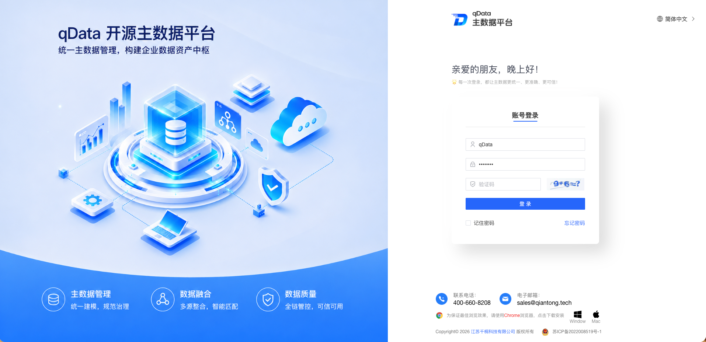</td>
      <td>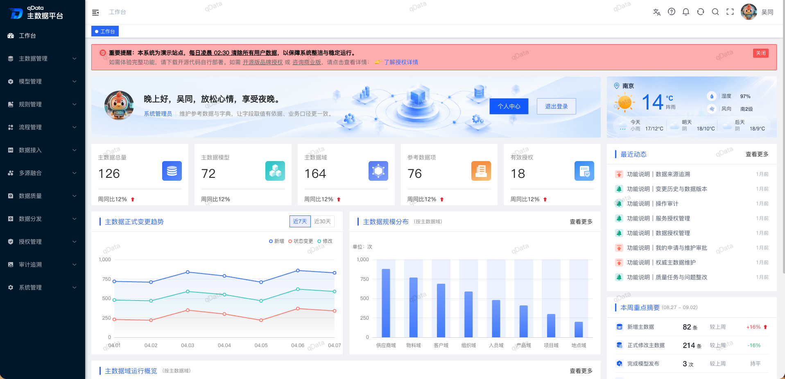</td>
    </tr>
    <tr>
      <td>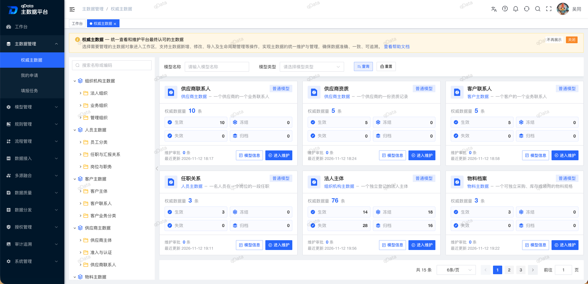</td>
      <td>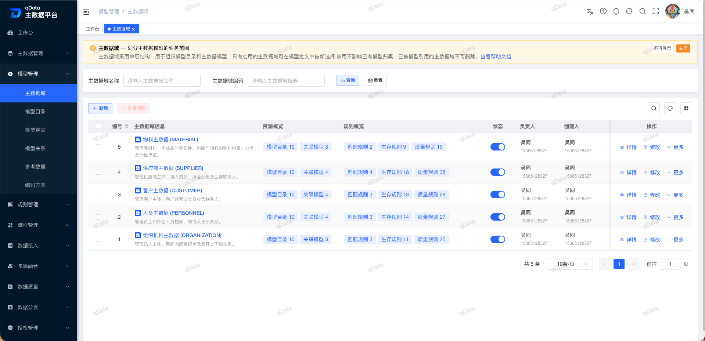</td>
    </tr>
    <tr>
      <td>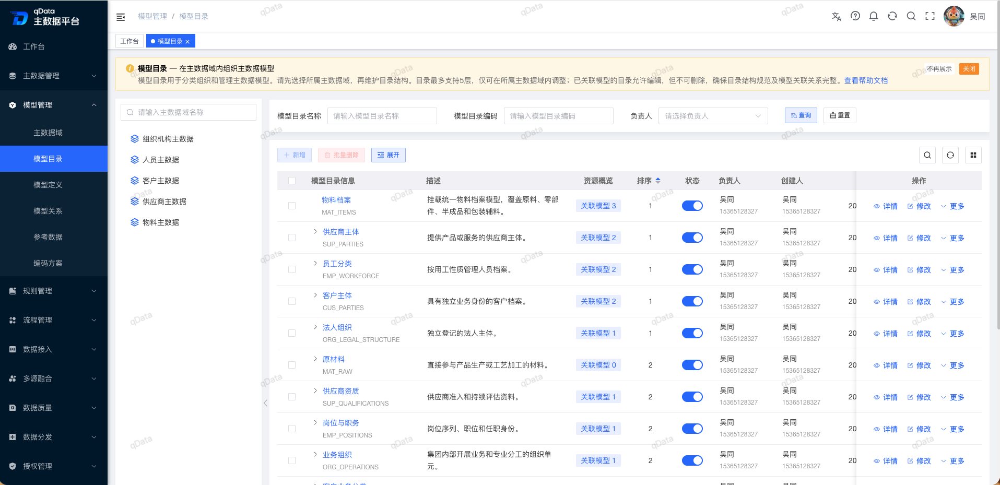</td>
      <td>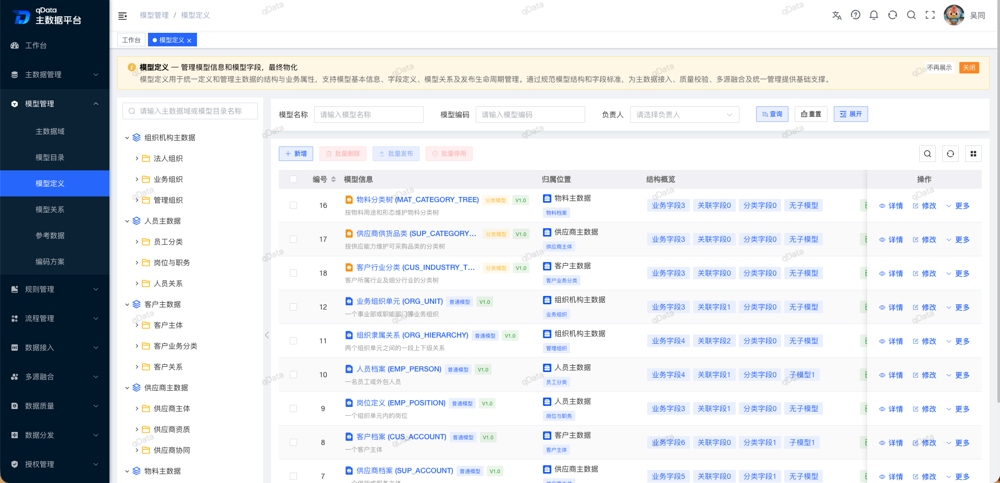</td>
    </tr>
    <tr>
      <td>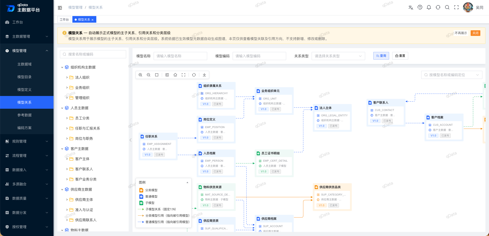</td>
      <td>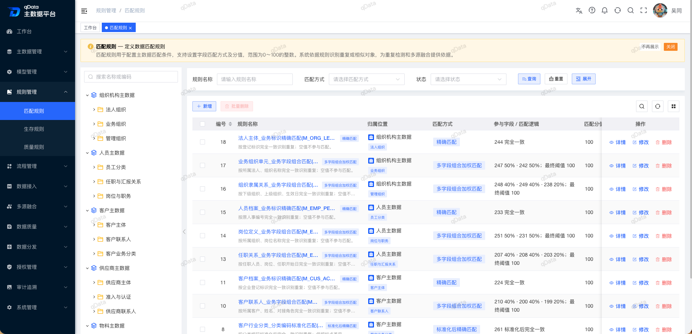</td>
    </tr>
    <tr>
      <td>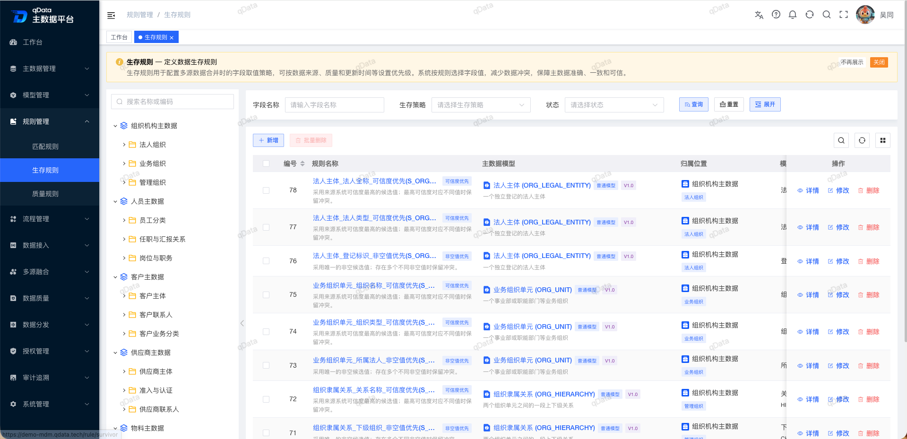</td>
      <td>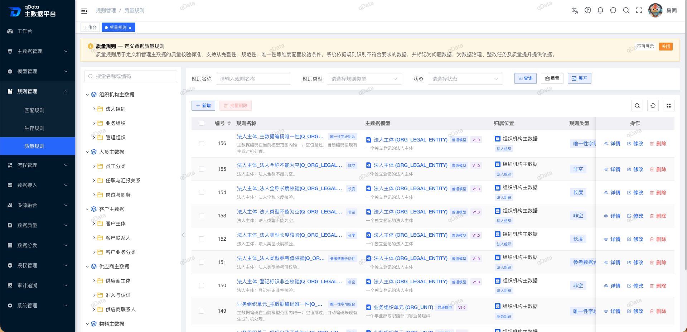</td>
    </tr>
    <tr>
      <td>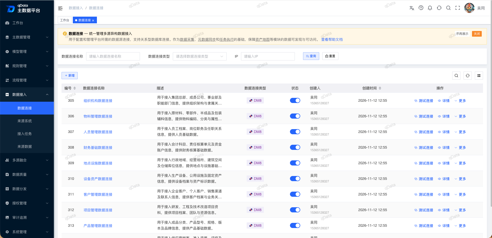</td>
      <td>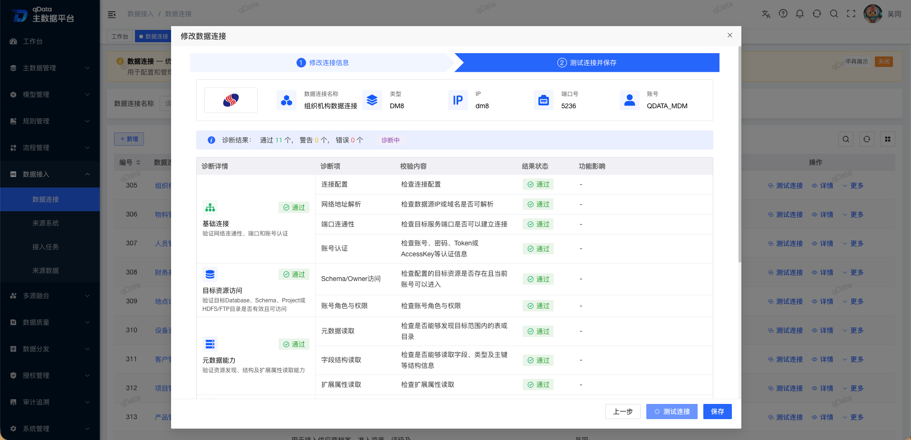</td>
    </tr>
    <tr>
      <td>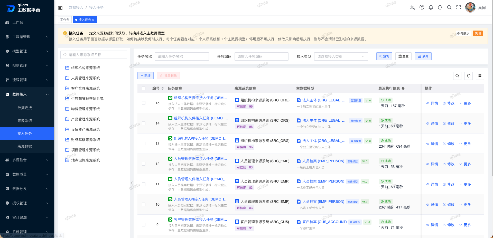</td>
      <td>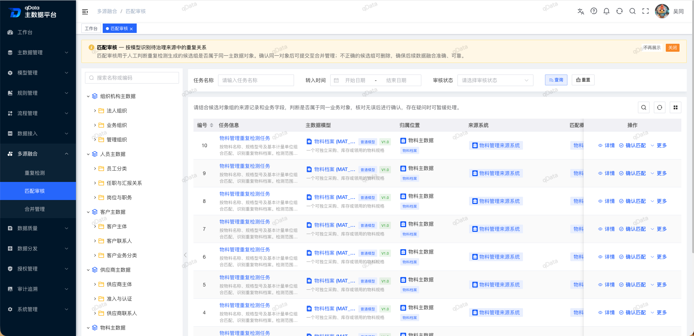</td>
    </tr>
    <tr>
      <td>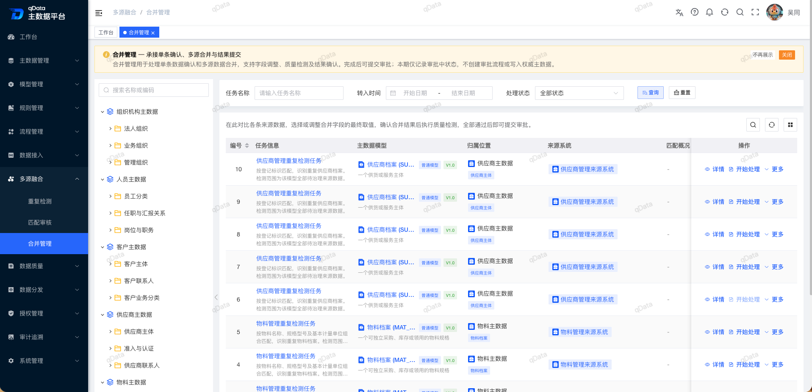</td>
      <td>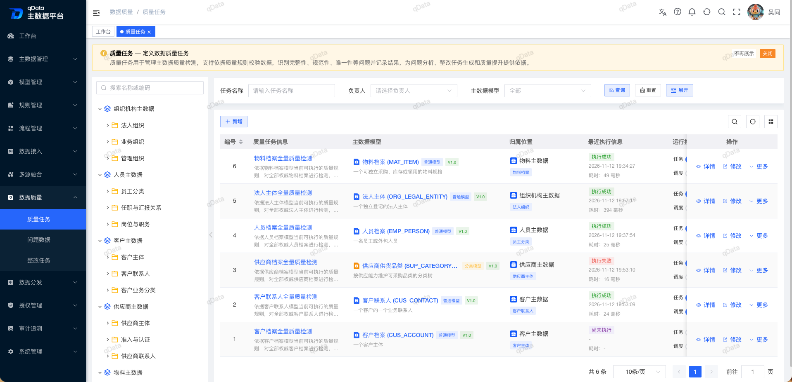</td>
    </tr>
    <tr>
      <td>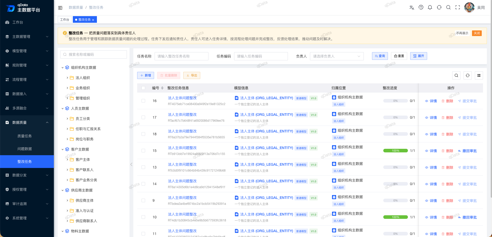</td>
      <td>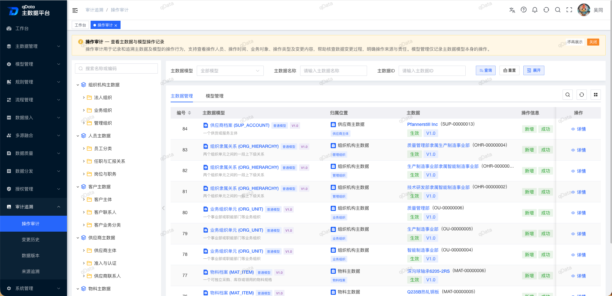</td>
    </tr>
</table>
