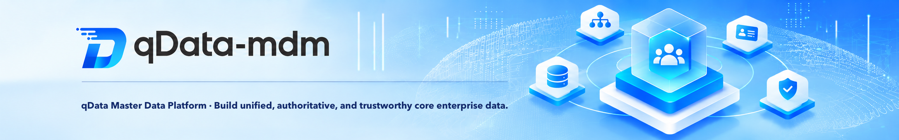
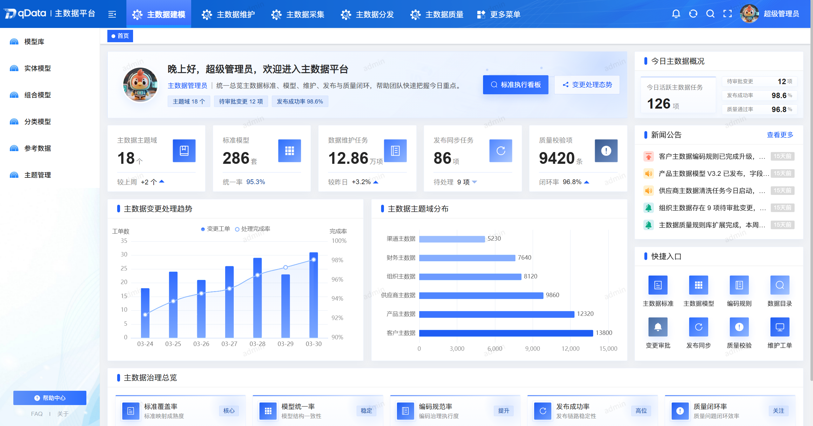
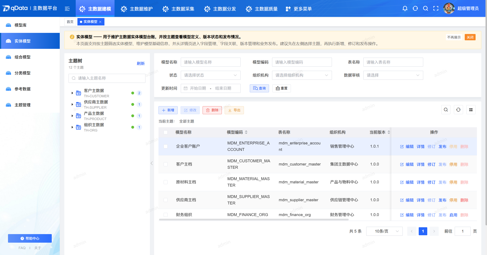
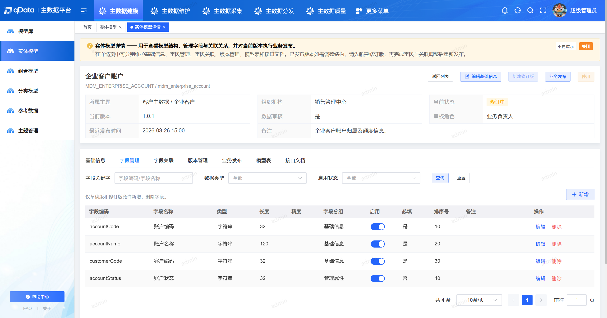
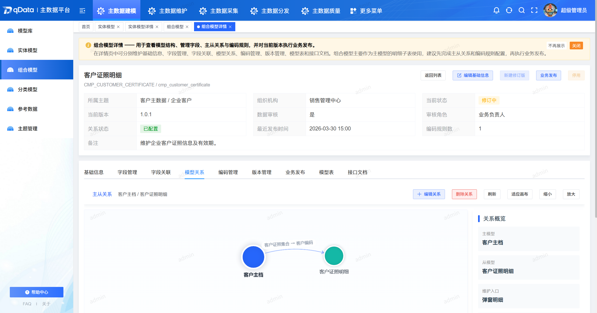
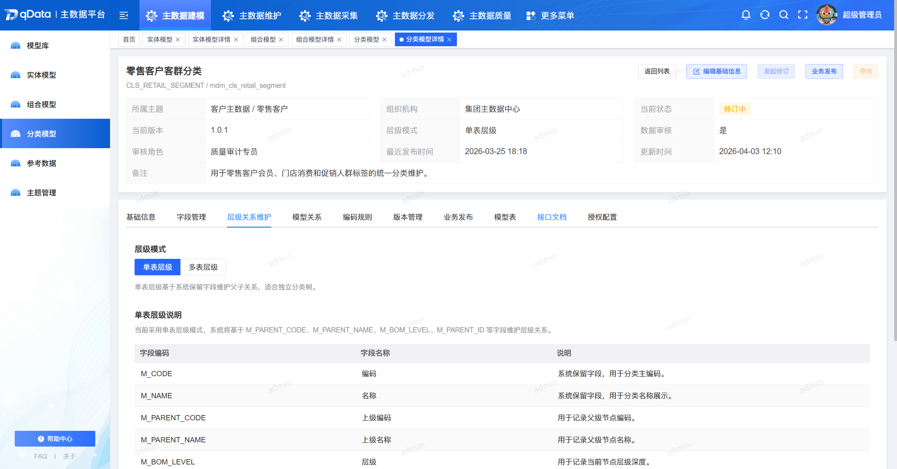
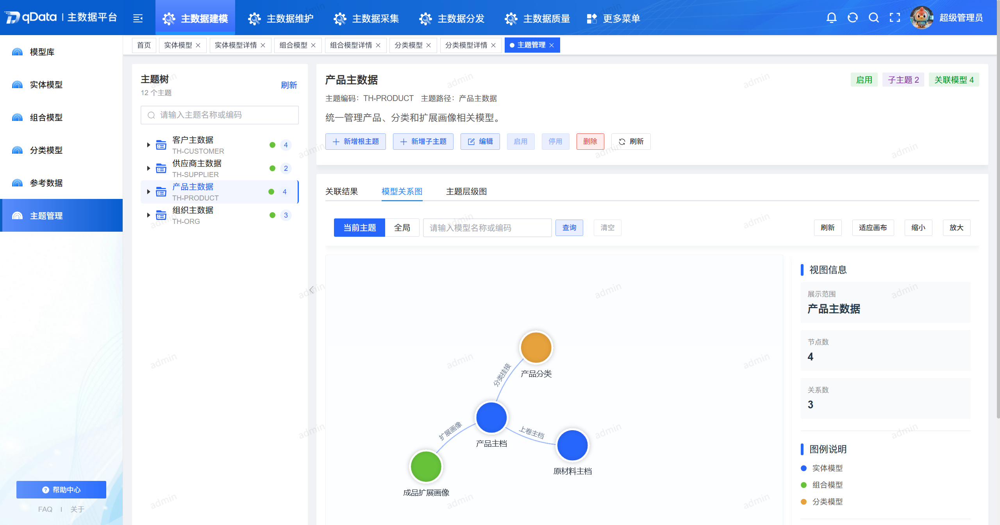

  
  
  
  
  

  
  

  <a href="README.zh-CN.md">📖简体中文</a> | 📖English | <a href="README.ja-JP.md">📖日本語</a>

## 🌈 Platform Overview

**qData-mdm** is a master data platform for managing records such as customers, suppliers, materials, and organizations. It organizes models by business domain, ingests and merges records from multiple systems into authoritative master data, and manages changes through approvals, quality checks, and remediation. Downstream systems can receive data through distribution tasks or query it through published services. The dashboard summarizes data volumes, lifecycle states, effective changes, and items requiring attention. Authorization and auditing support day-to-day maintenance and data sharing.

✨✨✨**Online Documentation**✨✨✨ <a href="https://qdata.qiantong.tech" target="_blank">https://qdata.qiantong.tech</a>

> If qData-mdm helps you, give the project a **star ⭐️** to support its development.

## 🍱 Use Cases

qData-mdm is designed for enterprises, corporate groups, and public-sector organizations that need consistent data standards, maintenance processes, and data sharing.

| Use case | Description | Typical users |
|----------|-------------|---------------|
| **Standardized master data modeling** | Organize models by business domain and directory. Define shared fields, classification hierarchies, relationships, reference data, and code generation rules. | Corporate groups, manufacturers, state-owned enterprises |
| **Centralized master data maintenance** | Manage requests to create, update, import, or change the lifecycle state of master data. Retain official versions, approval history, and source information. | Mid-sized and large enterprises, shared service centers |
| **Multi-source ingestion and consolidation** | Ingest records from business databases, files, and APIs. Identify duplicates across systems and produce authoritative records after review, quality checks, and approval. | Manufacturers, government platforms, IT project teams |
| **Master data distribution and sharing** | Push full or incremental data to ERP, HR, and finance systems, or provide authorized access through published read-only APIs. | Corporate groups, public-sector organizations, industry platforms |
| **Master data quality management** | Run scheduled quality checks, collect failures, assign remediation to the responsible people, and track outcomes. | Data governance, IT, and operations teams |

## 💡 Advantages

| Advantage | Description |
|-----------|-------------|
| **Versioned models and controlled publication** | The current model stays active during revisions. Publication checks compatibility, references, and data risks, while retaining previous versions and publication history. |
| **Traceable consolidation** | Retain matching evidence, field value origins, manual adjustments, check results, and approvals. Trace authoritative master data back to its source records. |
| **Unified task inbox** | A personal task center brings together approvals, data-entry assignments, and remediation tasks. Status updates follow their originating workflows. |
| **Granular authorization** | Control model access by row, field, and business action. External API calls use separate service authorization. |
| **Flexible deployment** | Run from source or deploy with Docker for installation, integration, and testing in different environments. |

## 📋 Feature List

| Core business function | Key capabilities |
|------------------------|------------------|
| **Master data modeling and publication** | Organize standard and classification models by domain and directory. Configure relationships and one-to-many submodels. Publish manually after validation and approval to create the physical schema. Revisions undergo compatibility checks and retain version history. |
| **Reference data and automatic code generation** | Maintain shared reference data and bind it to model fields to standardize allowed values. Version code rules that combine fixed text, business fields, reference data mappings, dates and times, and sequence numbers. Check uniqueness when issuing a code. |
| **Authoritative master data maintenance** | Query official records and related details by published model. Create, edit, copy, bulk update, import, and export records. Validate and apply bulk changes as a whole. Compare historical versions and submit a restoration request. |
| **Lifecycle and change approval** | Manage active, frozen, inactive, and archived records, with actions to freeze, unfreeze, deactivate, restore, or archive. Apply business approval rules to maintenance and status changes, and track requests, comments, and outcomes. |
| **Multi-source data ingestion** | Read databases in full or incrementally, import CSV, XLS, and XLSX files, or pull from external APIs. Use source identifiers and field mappings to detect changes, and retain ingestion versions and failure details. |
| **Duplicate detection and consolidation** | Detect duplicates through exact, fuzzy, or weighted multi-field matching. Review and split candidate groups manually. Recommend field values by source priority, trust score, recency, or non-empty value. Resolve conflicts, run quality checks, and submit the result for approval before it becomes authoritative. |
| **Quality checks and remediation** | Run manual or scheduled checks using rules for required values, formats, uniqueness, valid reference data, and cross-field logic. Collect failures with their causes, assign issues to responsible people, and track remediation. |
| **Data distribution and services** | Configure the data scope and field mappings for each target system. Push full or incremental data manually or on a schedule, including lifecycle changes. Publish read-only REST APIs for single-record and paginated queries. |
| **Data and service authorization** | Control model rows, fields, and business actions by user, role, or organization. Grant API access separately by caller, service, and validity period. |
| **Business auditing and source traceability** | Record key business operations and affected objects. Query changes and historical versions across models, and trace official records to source records, mappings, and approvals. |

💡 Have a suggestion or feature request? [Open an issue](https://gitee.com/qiantongtech/qData/issues).

## 🛠️ Technology Stack

qData-mdm separates the Spring Boot backend from the Vue 3 frontend and integrates authentication, database access, caching, and UI components.

<table>
  <tr>
    <th>Category</th><th>Technology</th><th>Purpose</th>
  </tr>
  <tr>
    <td rowspan="6">Backend</td><td>Spring Boot</td><td>Application framework for rapid development and consistent startup</td>
  </tr>
  <tr>
    <td>Spring Security</td><td>User authentication, authorization, and security controls</td>
  </tr>
  <tr>
    <td>MySQL, DM8</td><td>Persistent storage and data source configuration</td>
  </tr>
  <tr>
    <td>MyBatis-Plus</td><td>Database access and multiple data sources</td>
  </tr>
  <tr>
    <td>Redis</td><td>Caching, session state, and middleware</td>
  </tr>
  <tr>
    <td>Knife4j / OpenAPI</td><td>API documentation and integration testing</td>
  </tr>

  <tr>
    <td rowspan="3">Frontend</td><td>Vue 3</td><td>Reactive frontend framework</td>
  </tr>
  <tr>
    <td>Element Plus</td><td>UI components for the admin interface</td>
  </tr>
  <tr>
    <td>Vite</td><td>Development and build tooling</td>
  </tr>

  <tr>
    <td rowspan="2">Third-party libraries</td><td>AntV X6</td><td>Workflow diagrams, visual design, and interaction</td>
  </tr>
  <tr>
    <td>ECharts</td><td>Charts and data visualization</td>
  </tr>
</table>

## 🏗️ Deployment Requirements

Install the following prerequisites before deploying qData-mdm.

<table>
  <tr>
    <th>Environment</th><th>Component</th><th>Recommended version</th><th>Notes</th>
  </tr>
  <tr>
    <td rowspan="6">Backend</td><td>JDK</td><td>1.8 or later</td><td>OpenJDK 8 recommended</td>
  </tr>
  <tr>
    <td>Maven</td><td>3.6+</td><td>Build and dependency management</td>
  </tr>
  <tr>
    <td>DM8 / MySQL</td><td>8.0+</td><td>Relational database. Development configuration defaults to DM8.</td>
  </tr>
  <tr>
    <td>Redis</td><td>5.0+</td><td>Caching and session state</td>
  </tr>
  <tr>
    <td>Docker / Docker Compose</td><td>Optional</td><td>Quick evaluation and test deployments</td>
  </tr>
  <tr>
    <td>Operating system</td><td>Windows / Linux / Mac</td><td>All listed systems are supported</td>
  </tr>

  <tr>
    <td rowspan="3">Frontend</td><td>Node.js</td><td>16+</td><td>Frontend build tooling</td>
  </tr>
  <tr>
    <td>npm</td><td>8+</td><td>Package manager</td>
  </tr>
  <tr>
    <td>Chrome / Edge</td><td>Latest</td><td>Recommended for local debugging and access</td>
  </tr>
</table>

## 👥 QQ Community

Join the official qData QQ community for updates, technical support, and discussions.

👉 <a href="https://community.qdata.tech/discuss.html">Join the QQ community</a>

## 🖼️ System Screenshots

The screenshots show the Simplified Chinese interface.

<table>
  <tr>
    <td></td>
    <td></td>
  </tr>
  <tr>
    <td></td>
    <td></td>
  </tr>
  <tr>
    <td></td>
    <td></td>
  </tr>
</table>
