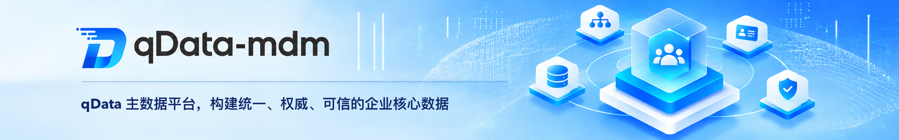

  
  
  
  
  

  
  

  📖简体中文 | <a href="README.md">📖English</a> | <a href="README.ja-JP.md">📖日本語</a>

## 平台简介
**qData主数据平台**帮助企业统一管理客户、供应商、物料、组织等主数据。企业可按业务域定义数据模型，将来自不同系统、描述同一业务对象的记录匹配并合并。合并结果经质量校验和审批后成为权威主数据，下游系统可通过数据分发或查询 API 获取一致的数据。平台保留来源记录和变更历史，便于追溯每条主数据的来源和历次修改。

✨✨✨**在线文档**✨✨✨ <a href="https://qdata.qiantong.tech" target="_blank">https://qdata.qiantong.tech</a>

✨✨✨**开源版演示地址**✨✨✨ <a href="https://demo-mdm.qdata.tech" target="_blank">https://demo-mdm.qdata.tech</a>（账号 `qData`，密码 `qData123`）

✨✨✨**专业版演示地址**✨✨✨ <a href="https://pro-demo-mdm.qdata.tech" target="_blank">https://pro-demo-mdm.qdata.tech</a>，演示账号请 [联系客服获取](https://community.qdata.tech/business/policy.html)。

> 如果 qData-mdm 对您有帮助，请点个 **Star ⭐️**，这是我们持续更新的动力！ 🚀

## 功能清单

| 模块 | 子模块 | 主要功能 |
| --- | --- | --- |
| **工作台** | 工作台 | 在权限范围内汇总主数据、模型、域、参考数据项和有效授权。查看各域数据规模、生命周期分布及近 7 天或 30 天的正式变更，从图表进入明细，或查看发布失败、授权即将到期等待关注事项。 |
| **主数据管理** | 权威主数据、我的申请、填报任务、任务中心 | 按已发布模型新增、修改、复制和导入导出数据；批量变更整批校验、整批生效。管理生效、冻结、失效和归档状态，对比版本并申请恢复。在“我的申请”跟踪或撤回申请，在任务中心处理审批、填报和整改待办。 |
| **模型管理** | 主数据域、模型目录、主数据模型、层级与关系、参考数据、编码方案 | 按域和目录组织普通模型与分类模型，配置字段、模型引用和 1:N 子模型，并在关系图中查看依赖。字段可绑定参考数据或分段编码方案。模型经校验、审核后手动发布并生成物理结构；修订时检查兼容性并保留历史版本。 |
| **规则管理** | 匹配规则、生存规则、质量规则 | 用精确、标准化、模糊或多字段加权匹配识别重复候选。按来源优先级、可信度、最新值或非空值推荐字段取值。配置必填、格式、范围、唯一性、参考数据及字段间逻辑校验。 |
| **流程管理** | 流程配置、流程实例 | 统一审批模型、主数据内容与状态变更，以及多源融合结果。查看当前节点、处理人、意见和审批轨迹。模型审核通过后仍需手动发布；数据与融合结果按业务规则生效。 |
| **数据接入** | 来源系统、接入任务、来源数据 | 支持数据库全量或增量读取、CSV/XLS/XLSX 文件导入及外部 API 拉取。按来源唯一标识定位记录，将来源字段映射到模型字段；内容未变时跳过，有变化时保留采集版本，可按运行批次排查失败记录。 |
| **多源融合** | 重复检测、匹配审核、合并管理 | 根据匹配分值和命中依据确认、拆分或暂缓候选组。单条记录可单独确认；多源记录逐字段处理冲突并保留取值来源。结果通过质量检测和审批后，新增或更新权威主数据。 |
| **数据质量** | 质量任务、问题数据、整改任务 | 手动或定时检测正式主数据，按记录归集失败规则、字段和原因。可将问题项分别派给责任人整改，后续检测通过后标记对应项已解决；问题由管理员确认后关闭。 |
| **数据分发** | 目标系统、分发任务、数据服务 | 为目标 API 配置数据范围、字段映射和调度，推送全量、增量及已分发记录的生命周期变化。也可发布只读 REST API，按主数据 ID 查询单条记录或按条件分页查询。 |
| **授权管理** | 数据授权、服务授权 | 按用户、角色或组织授予模型的行、字段和操作权限，查看最终权限及其来源。已发布 API 单独授权，按调用用户或客户端、服务及有效期控制访问。 |
| **审计追溯** | 操作审计、变更历史、数据版本、来源追溯 | 从成功的业务操作查看受影响对象，跨模型查询变更并对比任意两个正式版本。沿当前或历史映射，从权威记录追溯到人工录入或外部来源记录及相关审批。 |
| **系统管理** | 用户、角色、菜单、部门、岗位、字典、参数、通知公告、日志 | 维护账号和组织结构，通过角色控制菜单、按钮及数据权限。统一维护公共字典和运行参数，发布通知并检索操作与运行日志。 |

💡 如您有好的建议或功能需求，欢迎 [提交Issue](https://gitee.com/qiantongtech/qData-mdm/issues)，与我们共同完善主数据平台功能。

[//]: # (## 🧩 架构图)

[//]: # (![framework.png]&#40;images%2Fframework.png&#41;)

## 技术栈
qData-mdm 平台采用前后端分离架构，后端基于 Spring Boot，前端基于 Vue 3，并整合了主流的认证、数据库访问、缓存与前端组件能力。

<table>
  <tr>
    <th>分类</th><th>技术</th><th>描述</th>
  </tr>
  <tr>
    <td rowspan="6">后端技术栈</td><td>Spring Boot</td><td>提供快速开发能力与统一服务启动入口</td>
  </tr>
  <tr>
    <td>Spring Security</td><td>实现用户认证、授权与安全控制</td>
  </tr>
  <tr>
    <td>MySQL、达梦8</td><td>持久化存储与数据源配置管理</td>
  </tr>
  <tr>
    <td>MyBatis-Plus</td><td>简化数据库操作与多数据源访问</td>
  </tr>
  <tr>
    <td>Redis</td><td>支持缓存、登录态与基础中间件能力</td>
  </tr>
  <tr>
    <td>Knife4j / OpenAPI</td><td>提供接口文档展示与联调支持</td>
  </tr>

  <tr>
    <td rowspan="3">前端技术栈</td><td>Vue 3</td><td>现代化响应式前端框架</td>
  </tr>
  <tr>
    <td>Element Plus</td><td>常用 UI 组件支持与后台管理界面构建</td>
  </tr>
  <tr>
    <td>Vite</td><td>快速开发与构建工具</td>
  </tr>

  <tr>
    <td rowspan="2">第三方插件</td><td>AntV X6</td><td>支撑流程、图形化设计与可视化交互场景</td>
  </tr>
  <tr>
    <td>ECharts</td><td>支撑统计图表与可视化展示能力</td>
  </tr>
</table>

## 商用授权

qData-mdm 提供 **专业版** 与 **开源版** 两种形态，满足不同规模与场景下的用户需求。两者既各具特色，又形成互补：开源版更像启蒙老师，帮助低成本起步；专业版更像专家顾问，提供深度与保障。无论选择哪种版本，qData-mdm 都将成为可靠的伙伴，帮助企业释放数据价值，加速数字化进程。

> 👉 如需 **开源版品牌授权** 或 **咨询专业版**，请点击按钮查看详情：[💼 了解授权详情](https://community.qdata.tech/business/policy.html)

## 快速开始

### 1. 在线体验

- 登录[社区开源版演示环境](#平台简介)，无需安装即可了解主要功能。

### 2. 选择部署方式

- **本地部署**：使用 `deploy/docker/` 下的 Docker Compose 配置在本机启动完整环境。
- **源码启动**：分别启动后端 `qdata-mdm-server` 和前端 `qdata-mdm-ui`，适合开发和联调。
- **自主部署**：手动安装、配置和管理各项服务，适合生产环境和个性化配置。

## 部署环境

在部署 qData-mdm 之前，请确保以下环境和工具已正确安装：

<table>
  <tr>
    <th>环境</th><th>项目</th><th>推荐版本</th><th>说明</th>
  </tr>
  <tr>
    <td rowspan="6">后端</td><td>JDK</td><td>1.8 或以上</td><td>建议使用 OpenJDK 8 </td>
  </tr>
  <tr>
    <td>Maven</td><td>3.6+</td><td>项目构建与依赖管理</td>
  </tr>
  <tr>
    <td>达梦8 / MySQL</td><td>8.0+</td><td>关系型数据库环境，开发配置默认偏向达梦8</td>
  </tr>
  <tr>
    <td>Redis</td><td>5.0+</td><td>缓存与登录态等基础能力支持</td>
  </tr>
  <tr>
    <td>Docker / Docker Compose</td><td>可选</td><td>用于快速体验和测试环境部署</td>
  </tr>
  <tr>
    <td>操作系统</td><td>Windows / Linux / Mac</td><td>通用环境均可运行</td>
  </tr>

  <tr>
    <td rowspan="3">前端</td><td>Node.js</td><td>16+</td><td>前端构建工具依赖</td>
  </tr>
  <tr>
    <td>npm</td><td>8+</td><td>包管理器</td>
  </tr>
  <tr>
    <td>Chrome / Edge</td><td>最新版</td><td>推荐用于本地调试与系统访问</td>
  </tr>
</table>

## QQ交流群
欢迎加入 qData 官方 QQ 交流群，获取最新动态、技术支持与使用交流。

👉 <a href="https://community.qdata.tech/discuss.html">点击加入 QQ 交流群</a>

<!-- 

 -->

## 系统配图

<table>
    <tr>
      <td>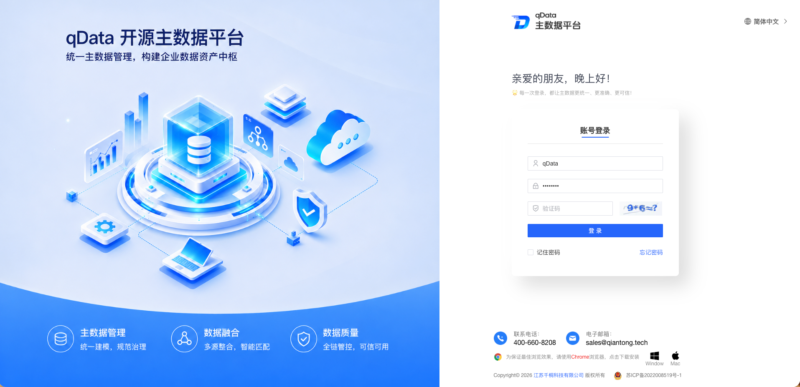</td>
      <td>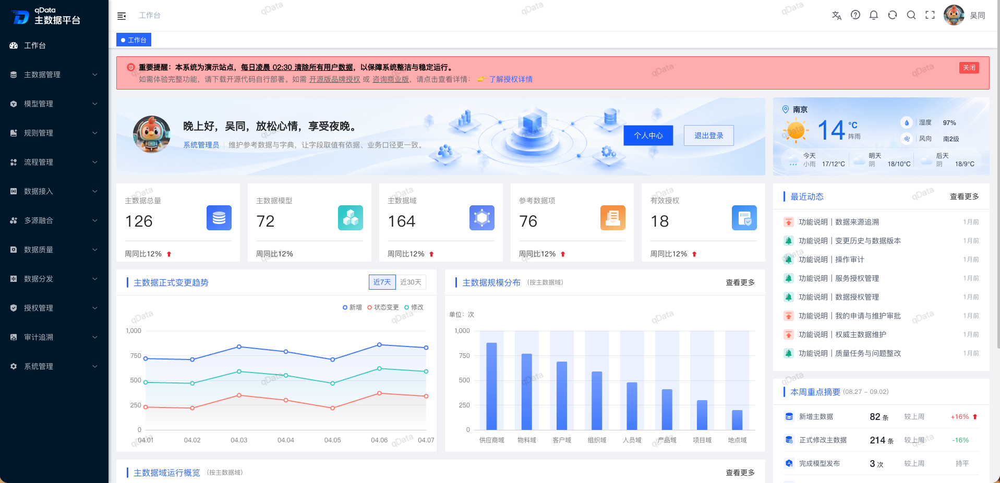</td>
    </tr>
    <tr>
      <td>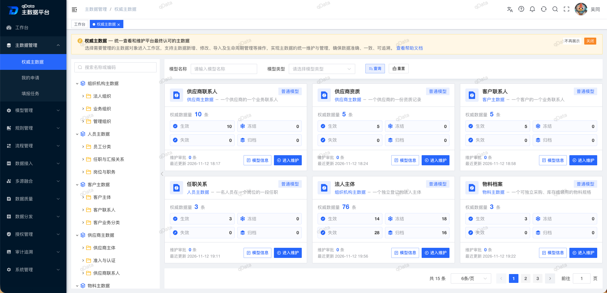</td>
      <td>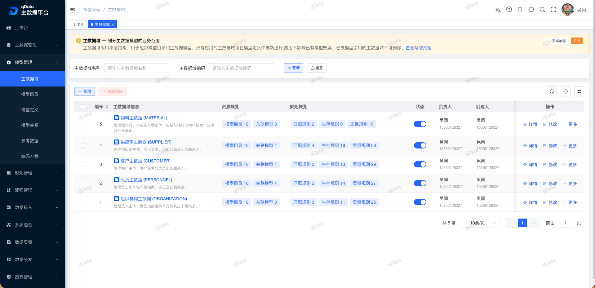</td>
    </tr>
    <tr>
      <td>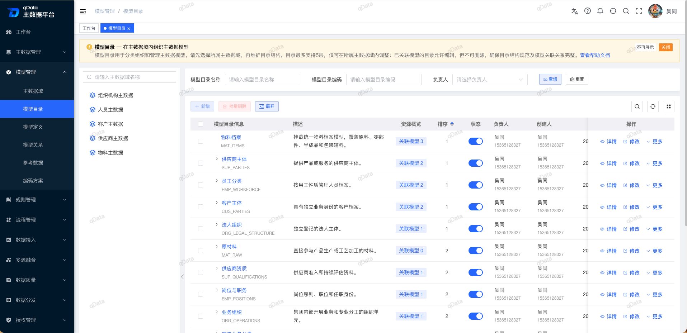</td>
      <td>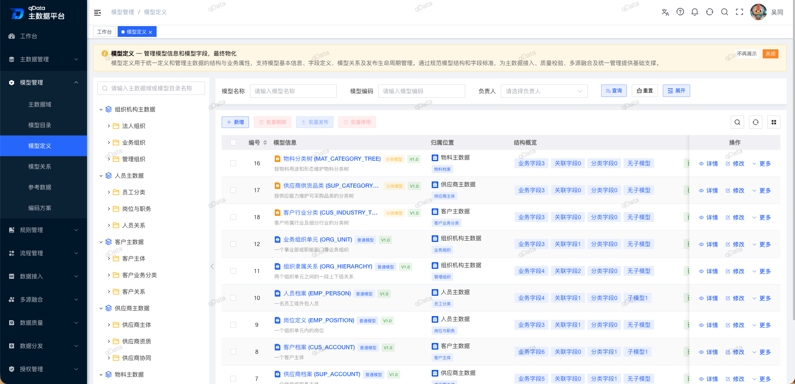</td>
    </tr>
    <tr>
      <td>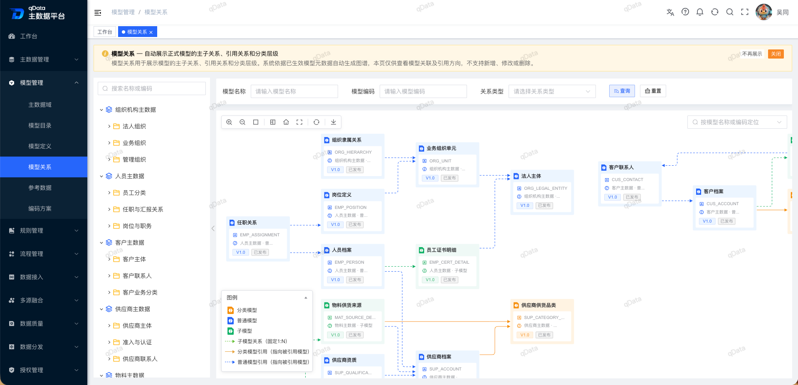</td>
      <td>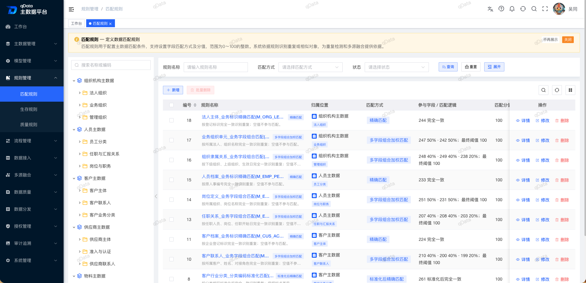</td>
    </tr>
    <tr>
      <td>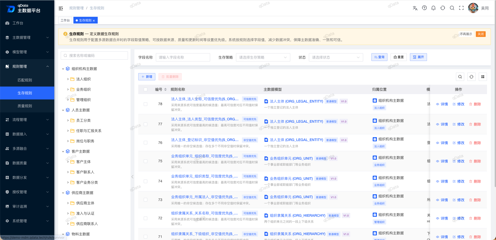</td>
      <td>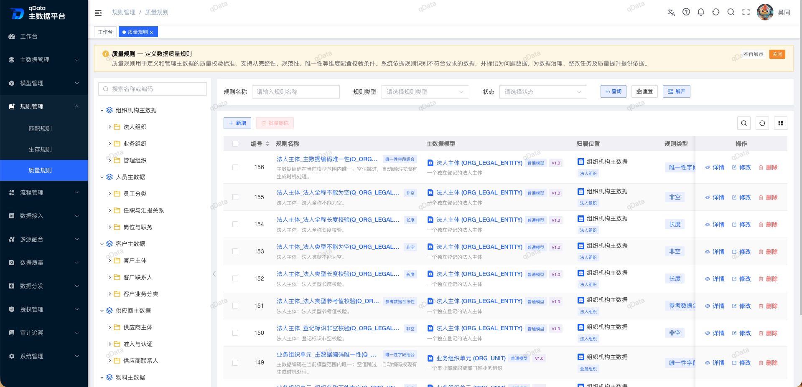</td>
    </tr>
    <tr>
      <td>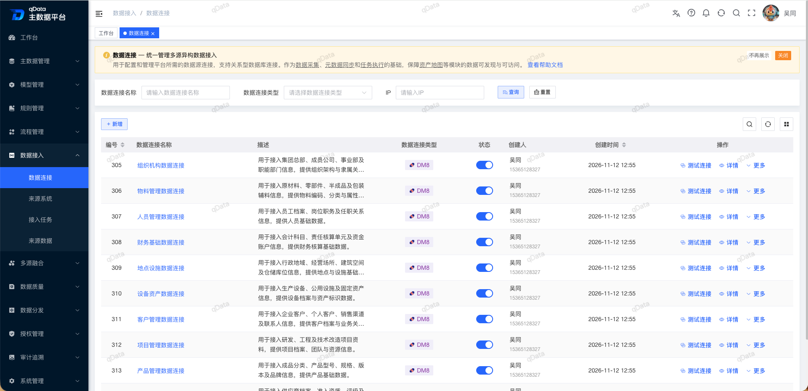</td>
      <td>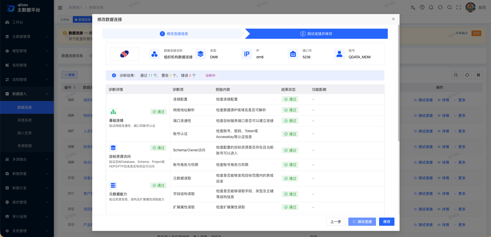</td>
    </tr>
    <tr>
      <td>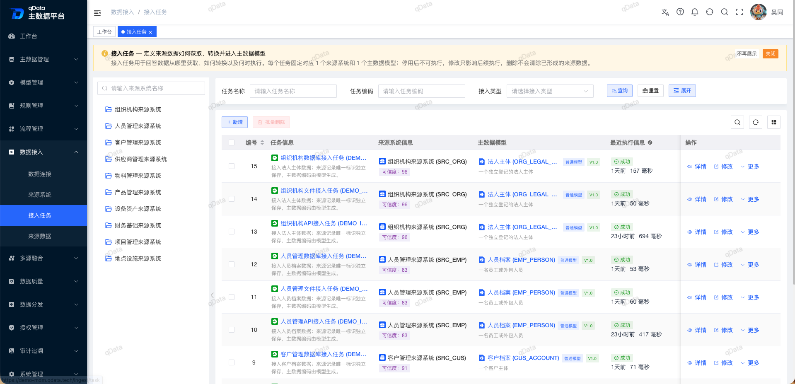</td>
      <td>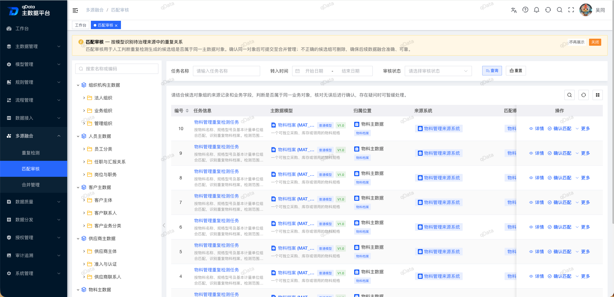</td>
    </tr>
    <tr>
      <td>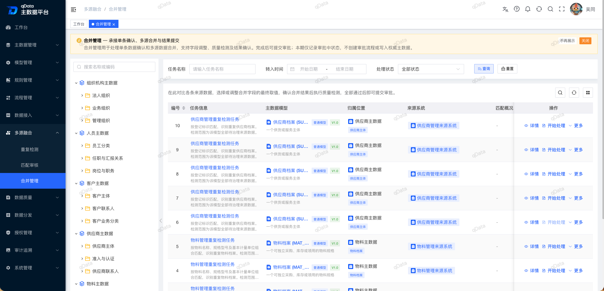</td>
      <td>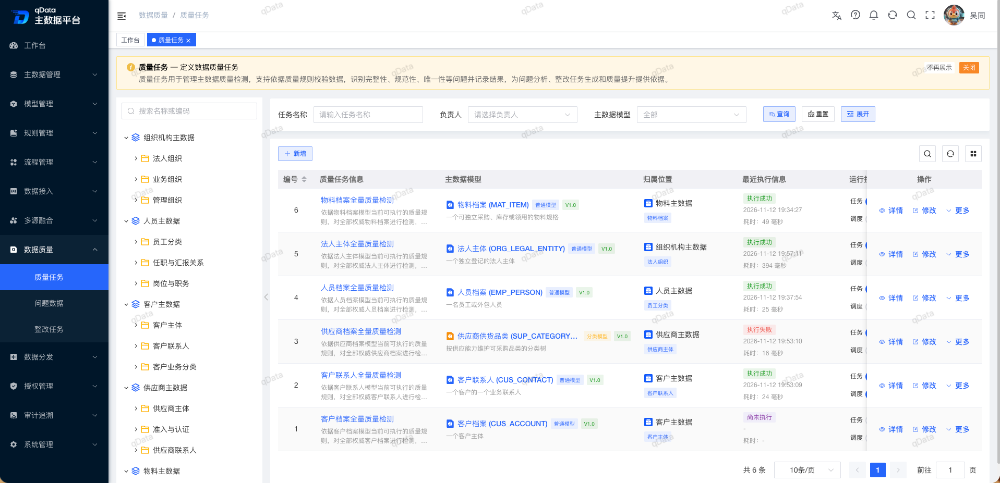</td>
    </tr>
    <tr>
      <td>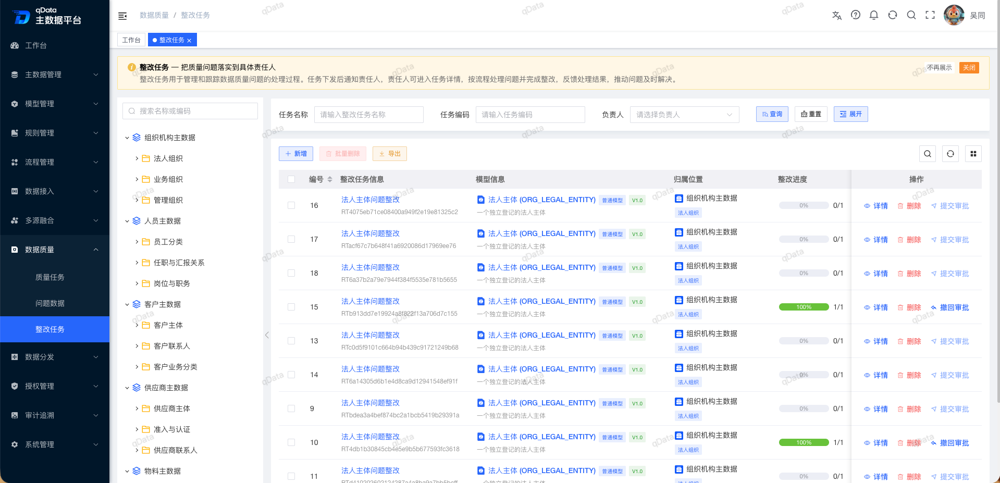</td>
      <td>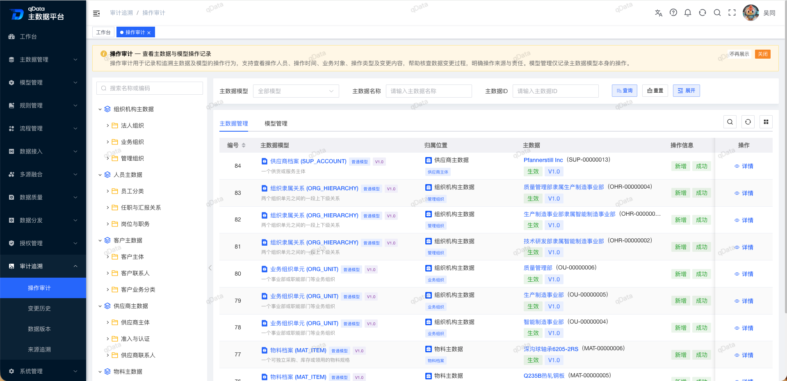</td>
    </tr>
</table>
